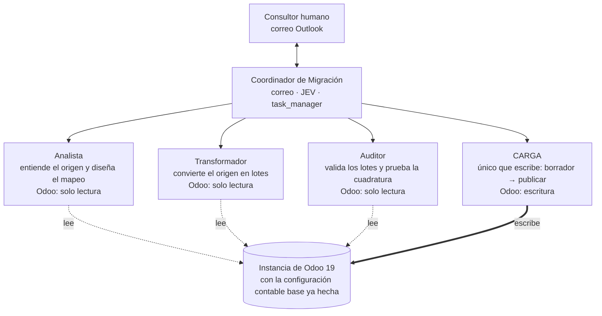

# Instructivo: implementar el multiagente de migración contable a Odoo 19

Este instructivo explica cómo montar el sistema de cinco agentes que migra la contabilidad histórica de un sistema de origen a Odoo 19: qué crear, en qué orden y qué probar antes de usarlo con un cliente. Los prompts y los skills a los que remite están en las demás carpetas de este paquete.

## Qué se construye

Un Coordinador y cuatro agentes migran la contabilidad por etapas, con una pausa humana entre ellas. Solo CARGA escribe en Odoo; los demás agentes solo leen.

Los agentes no se hablan entre sí: se pasan archivos en la carpeta `migracion/`, y el Coordinador abre cada tarea. El Auditor no construye ni carga lo que valida.

## Antes de empezar

Necesitas cinco nodos, accesos a Odoo y a correo, y tres capacidades de plataforma que los skills dan por supuestas.

- [ ] Plataforma de agentes con `task_manager`, `write_todos` y `jev` (skills de plataforma) y trigger por correo entrante.
- [ ] Dos usuarios de integración de Odoo, no cuentas personales: uno de solo lectura y otro con escritura.
- [ ] Una instancia de staging de Odoo.sh, neutralizada (correo saliente, crons y pagos deshabilitados). Producción solo al final.
- [ ] Una instancia con la configuración contable base ya hecha: compañía, localización, plan de cuentas e impuestos.
- [ ] Un sandbox de código que lea **y escriba** el workspace. Sin él, el Transformador no puede generar los lotes.
- [ ] Conector de correo Outlook (`ms_mail`), solo para el Coordinador.
- [ ] Los skills de tu biblioteca: `convencion-ids-externos`, `sandbox-de-codigo-en-opencompany` y `scripts-verificados-de-carga-odoo`.
- [ ] Una política de datos que permita que el Analista y el Transformador procesen archivos del cliente con RUT, nombres y montos.

## Nodos a crear

Son cinco nodos: solo el Coordinador tiene correo y solo CARGA tiene escritura en Odoo.

| Nodo | System prompt (carpeta `00-prompts/`) | Skills | Herramientas | Odoo |
| --- | --- | --- | --- | --- |
| Coordinador de Migración | `system-prompt-coordinador-migracion.md` | `orquestacion-migracion`, `puntos-de-control-migracion`, `correo-consultor-migracion`, `jev-migracion`, `contrato-migracion`; de plataforma: `task-manager`, `write-todos`, `jev` | `ms_mail`, `jev`, `task_manager`, `write_todos`, archivos | no |
| Analista de Migración | `system-prompt-analista-migracion.md` | `migracion-analisis`, `migracion-diseno`, `dominio-migracion`, `contrato-migracion`, `jev-migracion`, `odoo-rpc-transporte`, `taxonomia-errores-odoo`, `localizacion-chile`, `convencion-ids-externos`, `sandbox-de-codigo-en-opencompany` | archivos, `odoo_jsonrpc`, sandbox (lectura), `jev` | solo lectura |
| Transformador de Migración | `system-prompt-transformador-migracion.md` | `migracion-transformacion`, `dominio-migracion`, `contrato-migracion`, `convencion-ids-externos`, `localizacion-chile`, `sandbox-de-codigo-en-opencompany` | archivos, `odoo_jsonrpc`, sandbox (lectura y **escritura**) | solo lectura |
| Auditor de Migración | `system-prompt-auditor-migracion.md` | `migracion-auditoria`, `dominio-migracion`, `contrato-migracion`, `taxonomia-errores-odoo`, `odoo-rpc-transporte`, `localizacion-chile`, `sandbox-de-codigo-en-opencompany` | archivos, `odoo_jsonrpc`, sandbox (lectura) | solo lectura |
| CARGA Migración | `system-prompt-carga-migracion.md` | `migracion-carga`, `bucle-de-correccion`, `odoo-rpc-transporte`, `taxonomia-errores-odoo`, `entornos-y-seguridad`, `contrato-migracion`, `dominio-migracion`, `localizacion-chile`, `odoo19-diferencias`, `sandbox-de-codigo-en-opencompany`, `scripts-verificados-de-carga-odoo` | archivos, `odoo_jsonrpc`, sandbox (lectura) | **escritura** |

El Auditor no usa JEV a propósito: una comprobación contable no se delega en un modelo probabilístico.

## Instalación paso a paso

La instalación se hace en nueve pasos, en este orden; los pasos 1 a 7 son configuración y el 8 y el 9 son verificación.

1. Crea los cinco nodos con los nombres de la tabla anterior.
2. Conecta el Analista, el Transformador, el Auditor y CARGA al `input-teammates` del Coordinador.
3. Copia el ID de cada nodo a la tabla de equipo del prompt del Coordinador, en lugar de `<NODE_ID_ANALISTA>`, `<NODE_ID_TRANSFORMADOR>`, `<NODE_ID_AUDITOR>` y `<NODE_ID_CARGA>`.
4. Pega en cada nodo su system prompt y carga sus skills (propios, compartidos y de tu biblioteca).
5. Configura las credenciales de Odoo: solo lectura para el Analista, el Transformador y el Auditor; escritura únicamente para CARGA.
6. Conecta `ms_mail` solo al Coordinador, y `jev` al Coordinador y al Analista.
7. Configura el trigger del Coordinador: correo entrante, filtrado por el prefijo `[<empresa>-<sesion_id_corto>]` del asunto, para que no se despierte con correos ajenos.
8. Comprueba que el sandbox del Transformador pueda escribir en el workspace.
9. Ejecuta las pruebas de la sección "Pruebas antes de usarlo con un cliente".

## Cómo opera el proceso

El proceso se detiene cinco veces para que decida una persona; el Coordinador no avanza una etapa con definiciones abiertas.

| Punto | Qué se cierra | Quién lo prepara | Qué desbloquea |
| --- | --- | --- | --- |
| P1 · Entrada | El consultor entrega los archivos de origen y la fecha de corte | Coordinador (los pide y los guarda sin abrirlos) | `analisis` del Analista |
| P2 · Análisis | El consultor responde las definiciones: formato, calidad de datos, estado de la instancia, diarios de migración | Analista | `diseno` |
| P3 · Diseño | El consultor aprueba el diseño y valida las cinco tablas de mapeo | Analista | `transformacion` y `auditoria previa` |
| P4 · Cuadratura | El consultor aprueba la cuadratura previa a la carga | Auditor | La publicación de lotes por CARGA |
| P5 · Producción | Autorización explícita con base de datos y rama; solo si el entorno es producción | Coordinador | La carga en producción |

Después de P4, CARGA carga por fases: `preparacion`, `apertura`, `partidas_abiertas`, `historicos` y `conciliaciones`. Cada lote se carga en borrador, se verifica y recién entonces se publica. Al terminar, el Auditor ejecuta los controles de cuadratura contra el origen.

## Al arrancar cada cliente

Cada proyecto empieza con cuatro entregas al Coordinador; sin la segunda, no actúa sobre ninguna respuesta del consultor.

1. **Workspace.** Una carpeta `migracion/` vacía, con permiso de escritura del Coordinador en `00-entrada/fuente/`.
2. **Direcciones del consultor.** Las que irán en `coordinador/estado.json`, campo `consultores_autorizados`.
3. **Entorno.** Staging o producción, con nombre de la base de datos y rama.
4. **Instancia lista.** Compañía, localización, plan de cuentas e impuestos ya configurados. Si falta algo, el Analista lo reporta y no lo configura.

Con eso se lanza el Coordinador, que envía el correo de P1 pidiendo los archivos de origen y la fecha de corte.

## Pruebas antes de usarlo con un cliente

Antes de tocar datos reales, confirma en staging las hipótesis de Odoo que los skills dejan marcadas como `[hipótesis]` o `[VERIFICAR]`.

- [ ] Cargar y publicar un asiento de prueba en un diario de migración: confirmar que **no** genera ningún documento electrónico ni consume folios.
- [ ] Ver qué `name` toma el asiento al publicar: si conserva el número de origen o consume la secuencia de Odoo.
- [ ] Confirmar con `fields_get` los campos y métodos reales: estado del asiento, saldo, publicar (`action_post`) y conciliar (`reconcile`).
- [ ] Leer la configuración del diario (formato electrónico, tipo de documento) y las fechas de bloqueo de la compañía.
- [ ] Conciliar dos líneas de prueba y comprobar que el residual queda en cero.
- [ ] Confirmar que el Transformador escribe lotes en `06-lotes/` desde el sandbox.
- [ ] Confirmar que un correo de un remitente no autorizado no hace actuar al Coordinador.
- [ ] Ejecutar el proceso completo, de P1 a P5, con un archivo pequeño de prueba en staging y cuadratura en cero.
- [ ] Hacer el ensayo desde cero (restaurar staging y repetir la carga entera) antes de la primera migración a producción.

## Reglas que no se pueden saltar

Estas ocho reglas protegen datos contables que no se deshacen con un archivo corregido; los prompts y los skills ya las aplican, y no deben relajarse al configurar.

1. Lo migrado no genera documentos tributarios ni consume folios. Si aparece uno, se detiene toda la carga.
2. Nada se publica sin verificar el lote y sin la cuadratura aprobada por el consultor.
3. Un lote publicado es definitivo: no se recarga ni se edita. Un error se corrige con un asiento inverso o restaurando la base.
4. Producción exige ensayo exitoso en staging, respaldo previo y autorización con base de datos y rama.
5. Solo CARGA escribe en Odoo.
6. Los archivos del cliente no los abre el Coordinador ni se cargan completos al contexto de ningún agente.
7. JEV solo recibe encabezados y muestras enmascaradas, nunca datos reales.
8. Ningún agente corrige un dato del cliente ni "ajusta" un monto para que cuadre: una diferencia es una pregunta al consultor.

## Pendientes y contenido del paquete

Quedan tres temas de plataforma que este paquete no resuelve y varias hipótesis de Odoo por confirmar.

- **Sandbox con escritura.** Sin una capacidad de escritura del workspace, el Transformador no puede generar los lotes.
- **Llegada de los archivos de origen.** El Coordinador los guarda al recibirlos por correo; el tamaño máximo de adjuntos y la vía alternativa dependen de tu plataforma.
- **Confidencialidad.** Que el Analista y el Transformador procesen archivos con RUT, nombres y montos debe permitirlo tu política de datos.
- **Hipótesis de Odoo.** Los nombres de campo y de método están marcados `[hipótesis]` o `[VERIFICAR]` hasta probarlos en staging.
- **Preguntas de P2.** Las 18 preguntas y sus propuestas por defecto son una primera versión, a revisar con el equipo.
- **Skills duplicados.** Seis skills técnicos son copias de los del paquete de implementación; si corriges un hecho de Odoo en uno, corrígelo en ambos.

El paquete tiene 24 archivos:

| Carpeta | Contenido |
| --- | --- |
| `00-INSTRUCTIVO.md` | Este documento |
| `README.md` | Resumen, instalación y requisitos de plataforma |
| `00-prompts/` | Los cinco system prompts |
| `01-coordinador/skills/` | `orquestacion-migracion`, `puntos-de-control-migracion`, `correo-consultor-migracion` |
| `02-analista/` | `migracion-analisis`, `migracion-diseno` |
| `03-transformador/` | `migracion-transformacion` |
| `04-auditor/` | `migracion-auditoria` |
| `05-carga/` | `migracion-carga`, `bucle-de-correccion` |
| `06-compartidos/` | `contrato-migracion`, `dominio-migracion`, `jev-migracion`, `odoo-rpc-transporte`, `taxonomia-errores-odoo`, `entornos-y-seguridad`, `localizacion-chile`, `odoo19-diferencias` |
